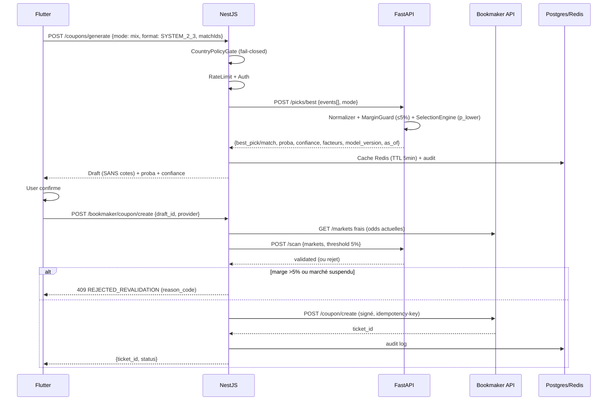

# ARCHITECTURE — Fail-Closed, Calibrée, Traçable

## 1. Principes

- **Probabilités calibrées, pas certitudes.** Calibration isotonic/Platt obligatoire, scoring conservateur `p_lower = p_model - k*sigma`.
- **Fail-closed.** Toute incertitude (marge incalculable, historique insuffisant, drift) → rejet, pas contournement.
- **Latence secondes.** Pré-calcul quotidien + cache Redis, endpoints <300ms hors latence bookmaker.
- **Traçabilité totale.** Chaque décision loggue: model_version, features hash, as_of, provider, reason_codes.

## 2. Diagramme système

```
                         ┌─────────────────────────────────┐
                         │   Flutter (Web + iOS + Android) │
                         │  - Aucune cote affichée         │
                         │  - FR/EN, onboarding pays       │
                         │  - Responsible Gambling banner  │
                         └──────────────┬──────────────────┘
                                        │ HTTPS (JWT)
                         ┌──────────────▼──────────────────┐
                         │   NestJS API (BFF) :3000        │
                         │  • Auth (JWT, refresh)          │
                         │  • Country Policy Gate          │
                         │  • Rate limit + Circuit Breaker │
                         │  • Orchestration coupon         │
                         │  • Proxy Bookmaker (signé)      │
                         │  • Audit logs → Postgres        │
                         │  • Cache Redis                  │
                         └──────┬───────────┬──────────────┘
                                │           │ HTTP interne
                    ┌───────────▼──┐   ┌────▼─────────────────┐
                    │  Postgres    │   │  FastAPI ML :8000    │
                    │  • users     │   │  • Normalizer 300+   │
                    │  • events    │   │  • Margin Guard ≤5%  │
                    │  • picks     │   │  • Selection Engine  │
                    │  • coupons   │   │  • Inference (Elo/  │
                    │  • virtual_  │   │    Dixon-Coles,      │
                    │    history   │   │    CatBoost)         │
                    │  • audit_logs│   │  • Calibration       │
                    └──────┬───────┘   │  • Drift detection   │
                           │           └────┬─────────────────┘
                    ┌──────▼──────┐         │
                    │   Redis     │   ┌─────▼────────┐
                    │ • picks du  │   │  MinIO/S3    │
                    │   jour      │   │ • datasets   │
                    │ • rate limit│   │ • models     │
                    │ • sessions  │   │ • backtests  │
                    └─────────────┘   └──────────────┘
                                │
                    ┌───────────▼────────────────────┐
                    │   Pipelines (cron)             │
                    │  • ETL Live Football API       │
                    │  • ETL Virtual (snapshots)     │
                    │  • Feature Store (versionné)   │
                    │  • Training + Calibration      │
                    │  • Backtests rolling           │
                    │  • Drift + Auto-disable        │
                    └───────────────────────────────┘
                                │
                    ┌───────────▼────────────────────┐
                    │  Bookmaker APIs (1xBet, Méga   │
                    │  Pari — même doc)               │
                    │  • /events, /markets, /odds    │
                    │  • /coupon/create (proxy)       │
                    │  • Snapshots horodatés          │
                    └────────────────────────────────┘
```

## 3. Flux temps réel (coupon)



## 4. Data Store

### 4.1 Postgres (schéma simplifié)

```sql
-- Core
users(id, email, password_hash, country_code, language, risk_profile, limits, created_at)
events(id, provider, sport, league, home, away, start_time, is_virtual, raw_payload_hash, created_at)
markets(id, event_id, market_type, period, line, raw_name, validated, margin_pct, created_at)
selections(id, market_id, name, odds_internal, tags, created_at) -- odds_internal jamais exposé API publique
picks(id, event_id, market_id, selection_id, p_model, sigma, p_lower, confidence, model_version, as_of, factors_json, created_at)
coupons(id, user_id, mode, format, selections_json, status, provider, ticket_id, audit_json, created_at)
virtual_history(id, event_id, snapshot_ts, markets_json, odds_json, result_json) -- complet
audit_logs(id, user_id, action, provider, model_version, as_of, reason_codes, payload_hash, created_at)

-- Feature Store
features(id, event_id, computed_at, as_of, feature_json, model_version)
model_versions(version, trained_at, metrics_json, calibration_plot_path, active)
```

### 4.2 Redis

- `picks:today:{league}:{event_id}` → best_pick pré-calculé (TTL 6h)
- `scan:margin:{market_hash}` → validated_options (TTL 60s)
- `rate:coupon:{user_id}` → throttle
- `session:{jwt_jti}` → blacklist

### 4.3 MinIO

- `s3://pred-models/{version}/model.pkl` + `calibration.json` + `metrics.json`
- `s3://pred-datasets/virtual/YYYY/MM/DD/snapshots.parquet`

## 5. Normalizer → Margin Guard → Selection Engine

**Normalizer** (FastAPI `core/normalizer.py`):
- Input: payload brut bookmaker (JSON hétérogène, champs manquants, odds "1,85", "", null)
- Output: schéma interne stable `Event/Market/Selection` (voir `packages/shared`).
- Gère 300+ marchés via taxonomie (exclusifs 2/3 issues, non-exclusifs Double Chance, sous-marchés lines).
- Marchés incomplets → `status: REJECTED_INCOMPLETE`.

**Margin Guard** (`core/margin_guard.py`):
- Parsing robuste: `None, "", "1,85"→1.85, 0, -1, NaN, inf, missing → rejet`.
- Formule: `marge% = (sum(1/odds) -1)*100` pour exclusifs.
- Double Chance: formule dédiée `1/DC = proba agrégée`, contrôle cohérence vs 1X2.
- Corners/tirs/fautes O/U: gère lines (ex: Over 9.5 vs Over 10.5 = sous-marchés distincts).
- Output: `validated_options` (marge ≤5%), sinon `rejected` + `reason_code`.

**Selection Engine** (`core/selection_engine.py`):
1. Éligibilité: Margin Guard + historique min (n≥30) + modèle compatible.
2. Scoring conservateur: `p_lower = p_model - k*sigma`, `k=1.0` par défaut, pénalités `fragile_market, drift, low_data`.
3. Choix: 1 pick/match déterministe (tie-break: score > confiance > market_type lexical).

## 6. Pipeline ML

- **Ingestion:** Cron 1h (réel) / 15min (virtuel). `pipelines/etl/`
- **Features:** `pipelines/training/features.py` — time split strict `as-of`, pas de fuite.
- **Training:** Elo → Dixon-Coles → CatBoost, calibration isotonic. `pipelines/training/train_real.py`
- **Backtests:** Rolling par ligue/saison, calibration plots. `pipelines/training/backtest.py`
- **Drift:** PSI + KS sur virtuel. Si drift fort → auto-disable marché + alerte. `pipelines/monitoring/drift_detection.py`
- **Scheduler:** `pipelines/jobs/scheduler.py` (APScheduler).

## 7. Sécurité & Compliance

- Secrets: uniquement env, jamais hardcodés, jamais exposés client.
- Revalidation marge avant chaque `createCoupon`.
- Country Gate: table `country_policies` + `ALLOWED_COUNTRIES`. Si absent → `403 COUNTRY_NOT_CONFIGURED` (fail-closed).
- Circuit breaker: `cockatiel` (NestJS) sur Bookmaker API, timeout 2s, retries 2 max.
- Audit: chaque décision loggée avec hash payload.

## 8. Observabilité

- Logs structurés (JSON) + trace_id.
- Métriques Prometheus: `picks_generated_total`, `margin_rejection_rate`, `drift_score`, `coupon_create_success`.
- Alerting: Grafana (latence p95>500ms, taux rejet marge >40%, drift PSI>0.2).

## 9. Scalabilité (lean → scale)

- Stateless API + ML (scale horizontal k8s).
- Pré-calcul batch quotidien (pas besoin temps réel <1k/j).
- Postgres partitions par saison pour virtual_history.
